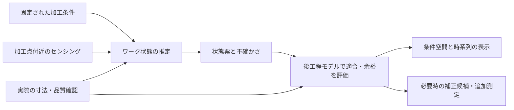

# rシリーズ次期構想：量産のワーク状態による工程適合の更新

記録日：2026-10-11（日本時間）

本書は、v005とr002の検証後に議論した構想を保存するもの。次期版の実装仕様・バンドル形式・リリース番号は未確定。本書の作成によって、既存モデルや予測処理を変更したものではない。

## 1. ユーザーが実現したいこと

前工程の条件空間で条件点・最適点が移動したとき、後工程の適合度がどう変わるかを把握し、条件空間上で可視化する。変更に応じて表示を更新する。

量産では前工程の操作条件は基本的に固定され、ワークごとに大きく変更されない。この運用では、加工点付近のセンシングを使い、固定条件の下で実現したワーク状態の違いを捉えて、後工程の適合度・余裕を更新することが中心になる。

現実のデータ収集上の前提：

- 各単工程は独立に評価されることが多い。
- 工程全体を通した関係データはほとんど得られない。
- 前工程の設定条件と加工中のセンシングを利用できる可能性がある。
- 後工程に渡す時点で、実施済みの前工程操作は固定されている。

この情報だけで工程間の未知の応答が自動的に分かる、とは仮定しない。

## 2. 中心となるコンセプト

**固定レシピ＋加工中の観測 → ワーク状態と不確かさ → 後工程の適合判定 → 必要時の補正・追加確認**

前工程の結果は、形状・表面・材料状態などとしてワークに残る。その状態を測定・推定し、ワークIDに紐づく状態票として後工程へ引き継ぐ。

状態票には、観測された値、推定された値、未知の項目を区別して保持する。信号を特徴量として使う場合も、どの状態・品質を説明できるかを検証する。

## 3. rとvの役割

### vシリーズ

単工程の操作条件と流入状態から、出力・品質を予測し、実験条件を提案する。単工程での実測、追記、再学習、履歴保存を担当する。

v005は実機評価用の基準版候補として扱う。単工程の限定実機評価へ進めることと、完成・量産適用を認定することは別の判断である。入力限定の効果、停止判断、予測適合確率の精度は引き続き確認する。

### rシリーズ

工程モデルとワーク状態を接続し、固定レシピの下で後工程の適合度を更新する。必要な場合に、許された操作範囲で補正候補を探索し、判断できない部分の測定・実験を選ぶ。

全工程の条件探索は、立上げ・条件変更・仮想比較の用途として残せる。量産の常時表示では、ワーク状態の更新と後工程の固定条件での適合確認を基本にする。

## 4. 引き継ぐ状態の例

現在の電気接続validationでは、以下が接続契約になっている。

|接続|項目数|主な状態量|
|---|---:|---|
|銅／アルミ切断 → 各成形|各13|厚さ、長さ、幅、バリ、粗さ、端部損傷・硬化、反り、酸化膜、汚染、降伏強度、弾性率、材種|
|銅／アルミ成形 → 組立|各21、計42|上記部品状態と、2か所の曲げ角誤差、パッド高さ・傾き、塑性ひずみ、残留応力、成形損傷、板厚損失|
|組立 → 溶接|26|上下材の厚さ・材種・強度・損傷・残留応力、3点の隙間と最大隙間、接触率・圧力、治具熱損失、酸化膜・汚染、粗さ、重なり、横ずれ、塑性セット、蓄積エネルギー|

例：**過曲げ角 → パッド高さ・傾き → 組立隙間 → 溶接の適合度**。

項目数は合成シミュレータの仕様であり、現実の最低必要測定項目を確定したものではない。潜在的な損傷、残留応力、表面状態などは、実測・代理測定・推定・未知を分ける。

接触圧や熱損失は治具・保持条件にも依存する。組立治具を維持するか、取り外して溶接治具へ付け替えるかで、引継ぎと再評価の扱いが変わる。

## 5. センシングの利用

候補例：成形の荷重・変位波形、形状画像、組立の拘束荷重・隙間計測、レーザー加工の光学信号など。採用する信号と特徴量は未決定。

確認する関係は二段階ある。

1. **センシング → ワーク状態**：単工程内で信号と寸法・形状等を対応測定し、推定誤差を確認する。
2. **ワーク状態 → 後工程品質**：物理知識・工程モデル・少数の対応確認で妥当性を確認する。

同一ワークID、加工位置、加工段階、時刻を対応づける。多点加工では局所的な状態も保持し、ワーク全体の平均だけで局所的な不適合を消さない。

信号は、入力する特徴量に加えて元波形・元画像の参照を残す。特徴抽出方法、センサ校正、推定器の版を記録する。後で得られる品質検査結果を、加工中には利用可能だった信号として混入させない。

固定条件の自然なばらつきが狭い場合、確認できるのはその近傍の適合・逸脱である。広い受入条件や大きな操作補正まで、同じデータで確定しない。

## 6. 状態票の契約案

バンドルが持つ工程モデルと、ワークごとに更新される状態票は別の単位で管理する。

|情報|内容案|
|---|---|
|識別・系譜|workpiece_id、lot_id、stage_id、合流する上下部品のID・組立組合せID|
|操作条件|実施した条件、固定済みの操作、今後変更できる操作と範囲|
|観測の位置・時刻|加工点、加工段階、測定時刻、観測が有効な保持・治具条件|
|状態量|名前、値、単位、実測／推定／未知の区別|
|不確かさ|測定・推定誤差、利用可能なら相関・標本、校正の有無|
|適用範囲|モデル支持度、範囲内／外、未経験状態の表示|
|追跡情報|センサデータ参照、特徴抽出・推定器・工程モデルの版|

具体的なJSONキー、欠測時の規則、時間更新方式は未確定。未知の状態を便宜的な代表値で埋める場合は、その仮定を明示する。

## 7. 「適合尤度」の意味と表示

会話上の「適合尤度」は、設計上は**指定した後工程条件と流入状態の下で、指定した品質制約を満たす予測確率**として整理する。統計モデルの尤度とは区別する。

確率を求めるには、どの変動・不確かさを含むかを定め、実際の合否との対応を検証する。測定誤差、状態推定誤差、モデル誤差、加工ばらつきを混同しない。複数状態・複数品質の相関がある場合、独立性を無条件に仮定しない。

確率を妥当に推定できない段階では、仕様余裕・支持度・未確認範囲を表示する。未校正の指標を製造良品率や保証として表示しない。

後工程条件の扱いは二つに分ける。

- **固定条件での評価**：上流状態の違いだけで後工程の適合がどう変わるか。
- **調整可能条件での評価**：許された範囲で後工程を探索し、どこまで適合を回復できるか。探索予算内の結果であり、最良値や受入範囲の厳密な証明ではない。

## 8. 可視化とリアルタイム更新

### 条件設計・仮想比較

前工程の条件空間に、最良点、変更後の点、軌跡を表示する。前工程条件を変更すると、出力状態を介して後工程の条件空間の色・等高線・仕様余裕を更新する。

### 量産監視

固定された設定点と、ワークごとの観測・推定状態を表示する。後工程の固定条件における適合度、余裕、変化した制約、未確認状態を更新する。設定点が動かなくても、後工程の適合領域・余裕はワーク状態に応じて変化し得る。

表示案：

- 前工程の条件空間と固定／変更点。
- ワーク状態の位置・分布・時系列。
- 後工程の条件空間と適合度・仕様余裕。
- 固定条件と補正候補の比較。
- 実測確認済み、モデル推定、情報不足、範囲外の区別。

多変数空間の2軸表示では、その他の入力を固定した断面か、分布を積分した表示かを明示する。各状態の周辺範囲を組み合わせて、存在しないワーク状態を作らない。

操作時・ワーク到着時は学習済みモデルで予測更新し、再探索は計算予算を決めて行う。再学習は別の処理として扱う。描画・予測・探索それぞれの更新周期と遅延目標は、対象設備・モデルで測定して決める。現状でリアルタイム性能を確認済みとはしない。

## 9. r002から再利用できる部分と不足

再利用候補：

- 工程DAG、入力・出力・単位・範囲の検査。
- incoming_contextによる状態入力。
- fixed_controls、completed_stages、observed_outputsによる固定条件・実施済み工程・観測出力の扱い。
- evaluate_acceptanceによる、上流状態を固定した下流の予算付き再探索。
- ワークID付き在庫、合流系譜、追加実験予算。

不足する主要な層：

- センサ信号処理と、観測からの状態推定。
- 観測・推定の不確かさと相関を扱う接続契約。
- 適合確率の計算範囲と校正・評価。
- ワークごとの継続更新、監視、リアルタイム画面。

現在のr002は、観測出力を平均値で渡し、そのstdを0としている。上流モデルの出力std・共分散を下流へ伝播する状態推定器ではなく、工程適合確率はNOT_EVALUATED。入力ばらつきのMonte Carlo評価も、測定ノイズ・モデル誤差・同時出力分布を含むものではない。

次期構想には中心用途の再定義と契約の拡張が必要だが、既存の接続・探索基盤は再利用できる。

## 10. v005バンドルへの影響

現在のbundle2.0には、操作と流入状態の役割、出力、単位、範囲、制約、予測平均・std・支持度がある。

- snapshot_hybrid：通常CLIで学習したNN＋残差GPを数値重みで保存する。エクスポート自体は再学習しない。
- fast_stage：別の高速モデルを学習するAPI。通常モデルを保存するために、このモデルへ置き換える必要はない。

変更内容ごとに影響を分ける。

|変更|予測への影響・対応|
|---|---|
|観測元・推定方法等の説明情報を追加|予測契約を維持して拡張できる。読込互換性を確認する|
|センシングを既存状態入力へ変換|必要な状態入力と学習応答が既存モデルにあれば、予測本体を維持できる|
|新しい入力・出力・特徴抽出を採用|次元・学習データ・モデルが変わり、再学習と単工程検証が必要|
|不確かさの校正・分布表現を変更|std・適合確率等への影響を別途検証する|

説明情報の追加と、入力範囲・列順・正規化・派生出力計算の変更を混同しない。後者は重みが同じでも予測を変える可能性がある。

最初は、**センシング → 状態推定 → 既存状態入力 → バンドル予測 → r側の適合評価**という構成を検討する。既存バンドルに必要な状態入力や、その変化への学習がない場合は、別の拡張モデルを用意する。

互換性の確認項目：旧バンドルの読込、同じ入力に対する平均・std・支持度の一致、単工程の推薦・停止・記録経路。説明情報を足しただけで、校正済み確率や未知の応答が得られたとは扱わない。

## 11. 最初の概念実証

一つの工程間接続に絞り、独立工程データだけでどこまで判断できるか、何を追加すると判断が改善するかを比較する。対象候補は成形→組立、または組立→溶接。最終選定は未決定。

1. 独立工程データだけを与える。
2. 加工中のセンシング・境界状態測定を追加する。
3. 少数の入口状態変更試験・接続確認を追加する。

評価案：

- 誤って合格と判断した件数、合格を見落とした件数、未評価とした範囲。
- 状態推定誤差と、品質・制約予測誤差。
- 確率を出す場合の校正と、ロット・時間を分けた検証。
- 測定・実験の追加件数、更新遅延、下流補正の実際の効果。

「同じ測定状態になった別由来の部品」で後工程結果が違う場合、状態票に不足がある可能性を調べる。測定項目を削減しても判断が維持されるかを比較し、最低限の候補を絞る。有限の試験で全域の必要十分性を証明したとは扱わない。

シミュレーション検証では、モデルへ許可した観測だけを与え、隠された物理正解は採点側に残す。センシングを合成する場合は、信号生成・ノイズの仮定を記録し、実機センシングでの有効性とは区別する。

## 12. これまでの検証から得た根拠

電気接続の6単工程の記録済み最良条件を接続した3組は、最終不合格だった。局所的に合格・最短の代表条件が、後工程にも適した状態を生成するとは限らない。

接続検証では、既存単工程データからの固定状態モデルと、実際の上流状態を含めた追加データの高速モデルを分けて評価した。後者の学習モデルの全工程首位候補は3組とも物理再評価で不合格。物理モデルを予測器にした全工程r002比較では3組とも合格条件を発見した。

この比較で使った高速モデルを、通常v005 NN＋GPそのものの性能と混同しない。また、既存trialが保存した最良代表1条件の接続結果から、同率最適条件を選び直しても接続できないとは結論しない。

参照ファイル：

- `../v005/trials/_interconnect_stage_20261010_focus_on/REPORT.md`：電気接続の独立単工程試験。
- `../v005/trials/_interconnect_link_20261010/REPORT.md`：記録済み条件の接続、学習モデルと物理比較、状態伝播グラフ。
- `../v005/README.md`、`README.md`：現行機能。
- `../v005/src/stage_bundle.py`、`../v005/src/bundle_schema.py`：バンドル保存・読込契約。
- `src/pipeline.py`、`src/api.py`：状態接続・受入評価。
- `../validation/multistage/electrical_interconnect/stages.py`、`../validation/multistage/electrical_interconnect/pipeline.py`：合成物理モデルの状態・接続定義。

## 13. 未決定事項

- 次期rの版番号、実装配置、バンドルの新しいschemaが必要か。
- 最初の対象工程、採用センサ、測定可能な状態項目。
- 状態推定器、誤差・相関の表現、欠測・分布外の扱い。
- 適合確率に含める変動と、その校正方法。
- 後工程で変更可能な操作と、固定条件での監視・補正の運用。
- 画面の更新周期・許容遅延、検証の合格基準・実験予算。

本書を起点に、これらを一接続の概念実証で具体化する。
